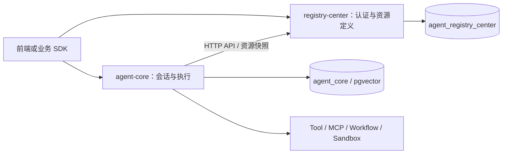

# 通用 Agent 平台

一个采用双服务架构的通用 Agent 平台，通过 Agent、Tool、Workflow、Prompt 和模型配置组装不同领域的执行能力。

## 项目结构

| 模块 | 职责 | 默认端口 |
| --- | --- | --- |
| `registry-center` | 认证与资源控制面：用户角色、Agent、Tool、Workflow、Prompt、模型、Knowledge、插件和发布配置 | 8089 |
| `agent-core` | 运行时：会话、规划、Tool/Workflow 执行、审批、恢复、记忆、事件、产物和审计 | 8081 |
| `frontend-web` | Vue 3 统一管理后台与对话界面 | 5173 |
| `agent-runtime-sdk-java` | 不依赖 Spring Boot 的 Java Runtime SDK | — |
| `agent-runtime-sdk-java-example` | 可执行的 SDK 宿主示例 | — |
| `agent-tool-plugin-gaokao` / `agent-tool-plugin-image` | 高考领域及图片理解插件 | — |

两个后端独立启动，使用独立逻辑数据库。跨服务数据通过 HTTP API 获取；Registry 签发 JWT，Core 本地校验。



## 当前功能

已实现会话与异步 Run、Decision/Planner、Workflow、审批恢复、Checkpoint、Memory、上下文压缩、HTTP/MCP Tool、Docker Sandbox、Runtime Event/SSE 续传、Simulation Replay、插件、图片输入、Java/TypeScript SDK，以及租户隔离、成本预算、评测和 Trace 运营页面。

`workflow_plan` 为默认执行模式；`interactive_loop` 通过显式 Feature Flag 与灰度配置启用。当前功能范围及生产验收事项见 [平台完成度与后续路线](docs/平台完成度与后续路线.md)。已有本地验证不能替代真实集群压测与生产恢复演练。

## 环境要求

1. Java 17、Maven 3.8+、Node.js 20+、npm、Python 3.7+。
2. PostgreSQL 和 pgvector。下面提供 PostgreSQL 16 的 Docker Compose 本地配置；已有数据库可直接配置连接地址。
3. Docker Engine / Docker Compose 用于本地数据库、Sandbox 和完整平台 E2E。
4. 文档 OCR 需要 Tesseract、`chi_sim`/`eng` 语言包和 Poppler 的 `pdftoppm`；纯文本功能不要求 OCR。
5. MCP stdio 所需 Node/Server 及 OCR 已提供 [Runtime Dockerfile](docker/runtime/Dockerfile)。

当前后端实际使用 Spring Boot 3.3.2、Spring Security、Spring JDBC / JdbcTemplate、Flyway 和供应商适配器；前端使用 Vue 3、TypeScript、Vite、Pinia、Vue Router、Element Plus 和 axios。MyBatis-Plus、Redis、LangChain4j 属于项目约定或扩展方向，当前启动不要求它们。

## 新环境快速启动

下面命令均从项目根目录执行；两个后端分别占用一个终端。

### 1. 生成本地配置

Windows PowerShell：

```powershell
python scripts/setup/local_env.py init
docker compose --env-file .env -f docker/compose.local.yml up -d
```

macOS / Linux：

```bash
python3 scripts/setup/local_env.py init
docker compose --env-file .env -f docker/compose.local.yml up -d
```

工具为每个新环境生成随机密码和密钥到 `.env`，并保证双服务 JWT 相同。已有 `.env` 时拒绝覆盖。`.env` 已加入 `.gitignore` 和 `.dockerignore`，不要上传。

Compose 仅用于全新本地数据库，初始化 `agent_registry_center`、`agent_core` 和 vector 扩展。已有 PostgreSQL 数据卷不会重新运行初始化 SQL；修改 `.env` 不会自动修改数据库已有密码。

### 2. 启动两个后端

Windows PowerShell，在两个终端分别执行：

```powershell
python scripts/setup/local_env.py run registry-center
```

```powershell
python scripts/setup/local_env.py run agent-core
```

macOS / Linux，在两个终端分别执行：

```bash
python3 scripts/setup/local_env.py run registry-center
```

```bash
python3 scripts/setup/local_env.py run agent-core
```

Spring Boot 不会自动加载 `.env`。上述工具以简单 `KEY=value` 格式读取文件，将配置传入子进程，不执行文件内容；操作系统进程环境优先。也可以自行设置全部必要环境变量后执行 `mvn -pl registry-center spring-boot:run` 或 `mvn -pl agent-core spring-boot:run`。

健康检查：`http://localhost:8089/api/health`、`http://localhost:8081/api/health`。

### 3. 启动前端

在 `frontend-web` 目录执行，Windows PowerShell 使用 `npm.cmd`，macOS / Linux 使用 `npm`：

```powershell
npm.cmd ci
npm.cmd run dev
```

```bash
npm ci
npm run dev
```

访问 `http://localhost:5173`。首次启动保留历史管理员用户名 `zc`，密码为本地 `.env` 中的 `REGISTRY_BOOTSTRAP_ADMIN_PASSWORD`；页面不再显示或预填账号密码。密码至少 12 个字符，UTF-8 编码最多 72 字节。成功初始化后可以移除该环境变量，后续重启不会重置已初始化账号。

未设置初始密码时，原始演示管理员保持锁定；配置后重启 Registry 即可完成初始化。

## 必要配置与已有环境升级

| 环境变量 | 用途 |
| --- | --- |
| `REGISTRY_DB_URL`、`REGISTRY_DB_USERNAME`、`REGISTRY_DB_PASSWORD` | Registry 数据库连接配置 |
| `AGENT_CORE_DB_URL`、`AGENT_CORE_DB_USERNAME`、`AGENT_CORE_DB_PASSWORD` | Core 数据库连接配置 |
| `REGISTRY_JWT_SECRET`、`CORE_JWT_SECRET` | 同一 JWT 签名密钥，建议至少 32 字节的随机值，两者必须一致 |
| `REGISTRY_RUNTIME_SERVICE_TOKEN` | 双服务共享的内部认证 Token |
| `REGISTRY_TOOL_ENCRYPTION_KEY` | 数据库中模型 API Key、Tool 凭据的加解密密钥 |
| `CORE_WAIT_WEBHOOK_SECRET` | 持久化等待 Webhook 的验签密钥，至少 24 字符 |
| `REGISTRY_BOOTSTRAP_ADMIN_PASSWORD` | 仅对迁移标记的原始演示管理员执行一次初始化 |
| `REGISTRY_ALLOWED_ORIGINS`、`CORE_ALLOWED_ORIGINS` | 可选的逗号分隔 Origin 列表，默认仅本机开发地址 |

完整字段见 [.env.example](.env.example)。Memory/Eval、图片 OCR、GitHub MCP 的 API Key 默认为空，可按需配置。模型管理页填写的 API Key 加密保存到 Registry 数据库，运行时按授权读取；后端密钥不得放入 `VITE_*`。

**已有数据库升级前：**

1. 从原部署环境、原部署 Jar 或安全备份中取回并保留原 `REGISTRY_TOOL_ENCRYPTION_KEY`。若旧环境没有显式设置，需要取原版本实际生效的配置值。不要对现有数据库使用新生成的随机加密密钥，否则旧凭据无法解密。轮换需要另行做解密、重加密迁移。
2. 在进程环境或本地 `.env` 中显式填写当前数据库密码、共享 JWT、服务 Token、Webhook 密钥和原加密密钥。不要把实际值复制到文档或提交中。
3. 新迁移仅锁定原始演示账号且密码哈希仍为旧默认值的账号；已改密码、已停用或已删除的账号保持原状。需要初始化时再提供初始密码。
4. 不修改旧 Flyway 脚本或手动清除 checksum。状态规则见 [数据库设计](docs/数据库设计.md)。

## 部署与测试

Linux / macOS 部署脚本使用 Bash。执行 [服务重建脚本](scripts/deploy/recreate_local_agent_services.sh) 前必须设置其要求的环境变量；脚本会重建名为 `agent-core`、`agent-registry-center` 的容器。Windows 使用 Linux / WSL 环境执行这些部署脚本，PowerShell 不直接执行 `.sh`。

Nginx 前端部署需挂载 [nginx.conf](docker/frontend/nginx.conf)，以支持 history 路由、同源 API 代理与 SSE。Runtime Jar 的插件加载及 SDK 示例见各模块 README。

在项目根目录验证：

```powershell
python scripts/security/check_secrets.py
python -m unittest discover -s scripts/test -p test_publication_security.py
mvn test
npm.cmd --prefix frontend-web run build
```

macOS / Linux 对应使用 `python3` 和 `npm`。完整 Docker / 浏览器回归执行 `bash scripts/ci-verify.sh`，或按 [测试与稳定性回归](docs/测试与稳定性回归.md) 选择检查。真实登录 E2E 使用 `PLATFORM_E2E_ADMIN_PASSWORD`，由平台脚本随机生成；禁止依赖页面预填密码。

## 发布到 GitHub

先按 [发布检查清单](docs/GitHub发布检查清单.md) 检查配置与待提交内容。凭据扫描是启发式检查，不能证明所有文本、附件、数据库或部署环境都没有敏感信息。公开过且仍有效的真实凭据需要撤销并替换，不能只删除代码。

当前源码快照无需包含旧 `.git`。准备好后可以新建 Git 仓库；`.github` 仅在需要 GitHub Actions 时添加，现有手动 CI 脚本可以独立使用。

## 开发约定与许可证

- [AGENTS.md](AGENTS.md)
- [双服务开发约定](docs/双服务开发约定.md)
- [MVP 开发计划](docs/MVP开发计划.md)
- [数据库设计](docs/数据库设计.md)
- [多 Agent 协作流程](docs/collaboration/多Agent协作流程.md)
- [安全说明](SECURITY.md)

本项目采用 [Apache License 2.0](LICENSE)。第三方依赖及外部资料保留各自的许可证和版权信息，发布前需确认你有权公开所包含的代码与资料。
